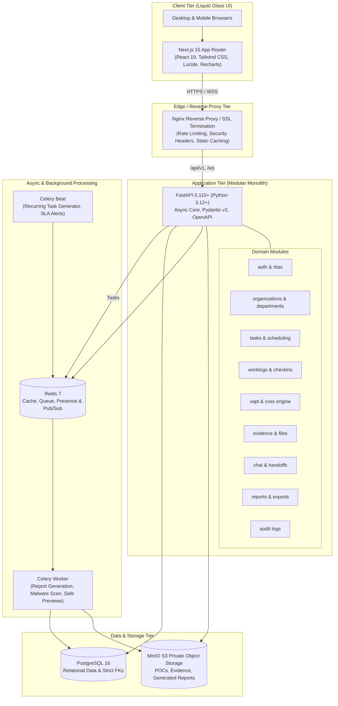

# EnterpriseOps — System Architecture

## 1. High-Level Modular Monolith Architecture
EnterpriseOps utilizes a high-performance **modular monolith architecture** running in Docker containers. This provides clean domain boundaries and strong typing without the complexity and latency of premature microservices.

---

## 2. Request & Authorization Flow
1. **Edge Filter**: Nginx verifies request limits, terminates TLS, sets CSP/HSTS/X-Frame-Options headers, and routes `/api/v1/*` and `/ws/*` to FastAPI, and all other routes to Next.js.
2. **Auth & Session**: FastAPI middleware validates HTTP-only secure JWT cookies or API bearer tokens with Argon2id-hashed credentials stored in PostgreSQL.
3. **Scoped RBAC Guard**: Every API operation inspects the target resource against the actor's permissions within the target Organization, Department, and Workspace scope (`check_permission(user, resource, action, scope)`).
4. **Data Isolation**: SQLAlchemy queries strictly enforce `WHERE organization_id = :org_id AND (department_id = :dept_id OR is_cross_department_authorized)`.
5. **Real-Time Dispatch**: Significant security events (High/Critical VAPT findings, alerts, mentions, chat) emit via Redis Pub/Sub directly to authenticated WebSockets.
