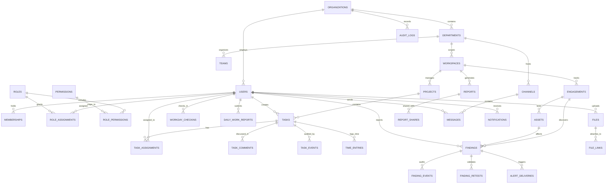

# EnterpriseOps — Database Entity Relationship Diagram (ERD)

---

## Key Relational Entity Groups

### 1. Hierarchy & Tenancy
- `organizations`: Root enterprise entity (name, slug, branding, settings).
- `departments`: Functional divisions (VAPT, Software Dev, QA, DevOps, SOC).
- `teams`: Sub-units inside departments (Android VAPT Team, Backend API Team).
- `workspaces`: Permission-isolated project domains (e.g., `android-security`, `web-development`).

### 2. Identity, Access & Scoped RBAC
- `users`: Core identity with Argon2id password hash, employee code, MFA settings.
- `roles` & `permissions`: Standard and custom role definitions with granular resource/action matrix.
- `role_assignments`: Scoped bindings linking users to roles at Org, Dept, or Workspace level.
- `memberships`: Explicit multi-tier organizational membership records.

### 3. Work Management & Operations
- `projects`: Scoped deliverables under a workspace.
- `tasks`: Full lifecycle items with priorities, categories, tags, deadlines, and recurrence links.
- `task_assignments`: Multi-user or team assignment with acceptance tracking.
- `workday_checkins`: "I'M ON WORK" attendance timestamps and status.
- `time_entries`: Discrete task work durations.
- `daily_work_reports`: Structured daily logs aggregated for PMO and Executive views.

### 4. VAPT & Vulnerability Lifecycle
- `engagements`: Pentest engagement scopes, methodologies, and date windows.
- `assets`: Target apps (Android APK, iOS, Web, API endpoints, CIDR ranges).
- `findings`: Comprehensive vulnerabilities with CVSS v4.0 / v3.1 vectors, CWE, CVE, and severities.
- `finding_retests`: Verification iterations with passing/failing logs.
- `alert_deliveries`: Real-time dispatch records for High/Critical vulnerability alarms.

### 5. Collaboration, Files & Governance
- `files` & `file_links`: Private S3-backed attachments with SHA-256 hashes and MIME filters.
- `reports` & `report_shares`: Generated multi-format exports with expiring access links.
- `handoff_requests`: Cross-department task remediation assignments (e.g. VAPT to Dev).
- `channels` & `messages`: Threaded real-time chat with WebSocket push.
- `audit_logs`: Immutable append-only audit trail with IP address and user agent logging.
